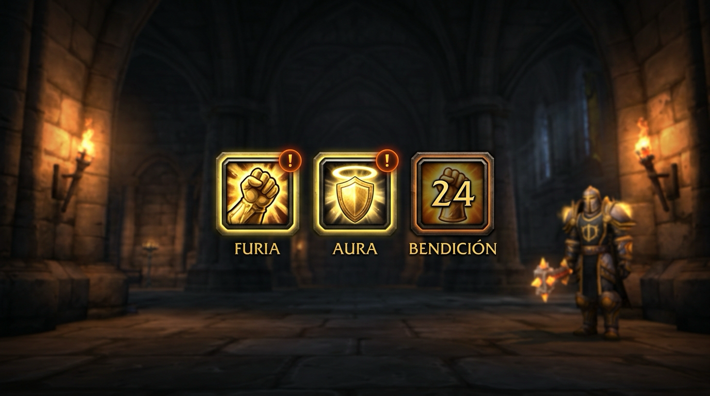

# 🛡️ PalaBuffGuard

**🇪🇸 Recordatorio inteligente y lanzamiento en 1 clic de los bufos del Paladín (Sagrado, Protección y Reprensión) para World of Warcraft: Forever (`1.60.1`).**  
**🇬🇧 Smart minimalist reminder & 1-click buffing for all 3 Paladin talent trees (Holy, Protection, and Retribution) in World of Warcraft: Forever (`1.60.1`).**

<p align="center">
  <a href="#-español-españa">🇪🇸 Español (España)</a> •
  <a href="#-english">🇬🇧 English</a>
</p>



---

## 🇪🇸 Español (España)

> **Cero ruido visual:** **PalaBuffGuard** permanece **100 % invisible** mientras llevas tus bufos activos. Solo aparece en pantalla cuando te falta un bufo esencial de tu rama de talentos o cuando a tu bendición le quedan **≤ 30 segundos**.

### ✨ Características principales (WoW Forever `1.60.1`)

* **Adaptación automática a las 3 ramas de talentos (`C_Traits`):**
  * **PalaBuffGuard** lee en tiempo real el árbol de talentos de **WoW Forever (`Interface: 16001`)** mediante `C_ClassTalents` y `C_Traits` (`Sagrado` / `Protección` / `Reprensión`).
  * **Furia justa inteligente:** En modo automático (`auto`, por defecto), **solo te avisa de *Furia justa* si estás en talentos de Protección**. Si juegas en **Reprensión** o **Sagrado** (o aún no tienes talentos de Protección), no te molestará pidiéndote *Furia justa*.
  * **Aura y Bendición en las 3 ramas:** Vigila que siempre lleves un **Aura** y una **Bendición** activas sin importar tu especialización, mostrando una **cuenta atrás** cuando a tu bendición le quedan 30 segundos o menos.
* **Lanzamiento en 1 clic adaptado a tu rama (fuera de combate):**
  * **Clic izquierdo:** Lanza a rango máximo el último bufo que hayas usado (o el recomendado según tu rama actual y hechizos aprendidos) directamente sobre ti (`[@player]`) sin perder tu objetivo enemigo.
  * **Clic derecho:** Alterna al bufo secundario de tu rama:
    * **Protección:** *Aura de devoción* ⇄ *Aura de represalia* | *Bendición de salvaguardia* (o *Poderío*) ⇄ *Sabiduría*.
    * **Reprensión:** *Aura de santidad* (o *Represalia*) ⇄ *Aura de devoción* | *Bendición del poderío* ⇄ *Sabiduría*.
    * **Sagrado:** *Aura de concentración* (o *Devoción*) ⇄ *Aura de represalia* | *Bendición de Sabiduría* ⇄ *Reyes* (o *Poderío*).
* **100 % seguro en combate:**
  * Usa `SecureHandlerStateTemplate` (`[combat] hide; show`) para retirar la capa clicable al entrar en combate: **jamás bloquea el giro de cámara con el ratón**, mientras cambia el borde a **rojo urgente con animación de rebote**.
* **Bilingüe nativo (`esES` / `enUS`):**
  * Detecta automáticamente el idioma de tu cliente de WoW Forever y traduce tanto las etiquetas del HUD (`FURIA`, `AURA`, `BENDICIÓN` / `FURY`, `AURA`, `BLESSING`) como los mensajes del chat y los nombres de los hechizos.

### 📦 Instalación

1. Descarga la última versión desde [Releases](../../releases) o clona este repositorio.
2. Copia la carpeta **`PalaBuffGuard`** dentro del directorio de AddOns de tu cliente de **WoW Forever**:
   ```text
   World of Warcraft/_forever_/Interface/AddOns/PalaBuffGuard/
   ```
3. Asegúrate de que `PalaBuffGuard.toc` y `PalaBuffGuard.lua` estén directamente dentro de `Interface/AddOns/PalaBuffGuard/`.
4. Reinicia el juego o escribe `/reload`.

### 🎮 Comandos en el juego (`ES`)

Puedes usar **`/pbg`** o **`/palabuffguard`** (también incluye `/bguard`, `/buffguard` y `/furia` como alias):

| Comando | Descripción |
| :--- | :--- |
| `/pbg` o `/pbg mover` | Desbloquea/bloquea los iconos para arrastrarlos por la pantalla (clic derecho para bloquear). |
| `/pbg status` | Muestra en el chat tu rama de talentos detectada (`Sagrado`, `Protección` o `Reprensión`), puntos (`X/Y/Z`) y estado de *Furia justa*. |
| `/pbg rf [auto\|on\|off]` | Cambia el aviso de **Furia justa**: `auto` (solo en Protección, por defecto), `on` (forzar siempre) u `off` (desactivar). |
| `/pbg aura` | Activa o desactiva el aviso de **Aura**. |
| `/pbg bendicion` | Activa o desactiva el aviso de **Bendición**. |
| `/pbg scale <0.4 - 2.0>` | Cambia el tamaño de los iconos (por defecto `0.85`). Ejemplo: `/pbg scale 1.0`. |
| `/pbg texto` | Muestra u oculta los textos inferiores (`FURIA`, `AURA`, `BENDICIÓN`). |
| `/pbg combate` | Alterna entre avisar **siempre** o **solo dentro de combate**. |
| `/pbg lang [es\|en]` | Cambia el idioma del addon entre **Español (`esES`)** e **Inglés (`enUS`)**. |
| `/pbg reset` | Restablece la posición, escala y opciones por defecto. |

---

## 🇬🇧 English

> **Zero visual clutter:** **PalaBuffGuard** stays **100% invisible** while your buffs are active. It only appears on screen when an essential buff for your talent spec is missing or when your blessing has **≤ 30 seconds** remaining.

### ✨ Key Features (WoW Forever `1.60.1`)

* **Automatic 3-Spec Talent Detection (`C_Traits`):**
  * **PalaBuffGuard** reads **WoW Forever's (`Interface: 16001`)** talent tree in real time via `C_ClassTalents` and `C_Traits` (`Holy` / `Protection` / `Retribution`).
  * **Smart Righteous Fury:** In automatic mode (`auto`, default), **it only alerts for *Righteous Fury* when you are in Protection talents**. If you are playing **Retribution** or **Holy** (or have no Protection talents spent), it will never nag you about *Righteous Fury*.
  * **Aura & Blessing across all 3 specs:** Monitors your active **Aura** and **Blessing** in every specialization, displaying a live **countdown timer** when your blessing has 30 seconds or less remaining.
* **Spec-Aware 1-Click Buffing (out of combat):**
  * **Left-Click:** Casts the last buff you used (or your spec's smart default) at max rank on yourself (`[@player]`) without dropping your current hostile target.
  * **Right-Click:** Casts your spec's secondary buff:
    * **Protection:** *Devotion Aura* ⇄ *Retribution Aura* | *Blessing of Sanctuary* (or *Might*) ⇄ *Wisdom*.
    * **Retribution:** *Sanctity Aura* (or *Retribution*) ⇄ *Devotion Aura* | *Blessing of Might* ⇄ *Wisdom*.
    * **Holy:** *Concentration Aura* (or *Devotion*) ⇄ *Retribution Aura* | *Blessing of Wisdom* ⇄ *Kings* (or *Might*).
* **100% Combat-Safe:**
  * Uses `SecureHandlerStateTemplate` (`[combat] hide; show`) to automatically hide click overlays upon entering combat: **it never blocks mouse camera turning**, while switching missing alerts to an **urgent red bouncing border**.
* **Native Bilingual Support (`enUS` / `esES`):**
  * Automatically detects your WoW Forever client locale for HUD labels (`FURY`, `AURA`, `BLESSING` / `FURIA`, `AURA`, `BENDICIÓN`), chat messages, and spell names.

### 📦 Installation

1. Download the latest release from [Releases](../../releases) or clone this repository.
2. Copy the **`PalaBuffGuard`** folder into your **WoW Forever** AddOns directory:
   ```text
   World of Warcraft/_forever_/Interface/AddOns/PalaBuffGuard/
   ```
3. Ensure `PalaBuffGuard.toc` and `PalaBuffGuard.lua` sit directly inside `Interface/AddOns/PalaBuffGuard/`.
4. Restart the game or type `/reload`.

### 🎮 In-Game Commands (`EN`)

Use **`/pbg`** or **`/palabuffguard`** (`/bguard`, `/buffguard`, and `/furia` also work as aliases):

| Command | Description |
| :--- | :--- |
| `/pbg` or `/pbg move` | Unlocks/locks the icons so you can drag them anywhere on screen (right-click to lock). |
| `/pbg status` | Prints your detected talent spec (`Holy`, `Protection`, or `Retribution`), points (`X/Y/Z`), and *Righteous Fury* tracking state. |
| `/pbg rf [auto\|on\|off]` | Sets **Righteous Fury** tracking mode: `auto` (Protection only, default), `on` (always force), or `off` (disable). |
| `/pbg aura` | Toggles the **Aura** reminder on or off. |
| `/pbg blessing` | Toggles the **Blessing** reminder on or off. |
| `/pbg scale <0.4 - 2.0>` | Adjusts icon scale (default `0.85`). Example: `/pbg scale 1.0`. |
| `/pbg text` | Shows or hides the bottom labels (`FURY`, `AURA`, `BLESSING`). |
| `/pbg combat` | Toggles between alerting **always** or **in combat only**. |
| `/pbg lang [en\|es]` | Switches addon language between **English (`enUS`)** and **Spanish (`esES`)**. |
| `/pbg reset` | Resets position, scale, and settings to defaults. |

---

## 🛠️ Estructura / Project Structure

```text
PalaBuffGuard/
├── PalaBuffGuard.toc   # WoW Forever (Interface 16001) metadata (EN / esES)
├── PalaBuffGuard.lua   # Core addon, C_Traits 3-spec detector & secure HUD
├── docs/
│   └── preview.png     # HUD showcase preview
├── CHANGELOG.md        # Bilingual version history (ES / EN)
├── LICENSE             # MIT License
└── README.md           # Bilingual documentation (ES / EN)
```

## 📄 Licencia / License

MIT © [moisesvalero](https://github.com/moisesvalero)
